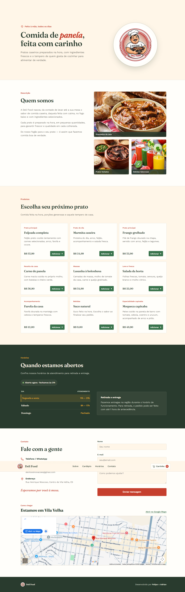

# 🍲 Deli Food

Site institucional de um restaurante de comida caseira, desenvolvido em dupla como atividade da disciplina **Fundamentos de Desenvolvimento Web** no CEET Vasco Coutinho.

🔗 **Ver o site no ar:** [adrianoliveiradev.github.io/deli-food](https://adrianoliveiradev.github.io/deli-food/)

## 📸 Prévia

## ✨ O que o site tem

- **Início:** apresentação com chamada principal e logotipo
- **Quem somos:** história do restaurante com cartões de pratos
- **Cardápio:** principais pratos com descrição e preço
- **Horários:** tabela de funcionamento e informações de entrega e retirada
- **Contato:** dados de contato e formulário de mensagem
- Menu de navegação que leva a cada seção da página

## 📚 O que eu pratiquei

- Estrutura de uma página completa em HTML5, dividida em seções
- Layout com CSS Grid e Flexbox
- Design responsivo com `@media`, adaptando a página para celular e computador
- Variáveis CSS para a paleta de cores e fontes do Google Fonts
- JavaScript para tratar o envio do formulário e exibir a mensagem de confirmação
- Trabalho em dupla e uso de Git e GitHub

## 🛠️ Tecnologias

  

## ▶️ Como ver o projeto

1. Acesse o [site no ar](https://adrianoliveiradev.github.io/deli-food/), ou
2. Baixe ou clone este repositório e abra o arquivo `index.html` no navegador.

## 📝 Observação

Projeto educacional. O formulário de contato apenas simula o envio: a mensagem de confirmação aparece, mas nenhum dado é enviado para lugar algum.

## 👥 Autores

- **Adrian de Oliveira Prates** — [GitHub](https://github.com/AdrianOliveiraDev) · [LinkedIn](https://linkedin.com/in/adrian-de-oliveira-prates-3853b040a)
- **Felipe** — [GitHub](https://github.com/FelipeBarbosaDeV-cpu) · [LinkedIn](https://www.linkedin.com/in/felipe-barbosa-a1692942a/)
